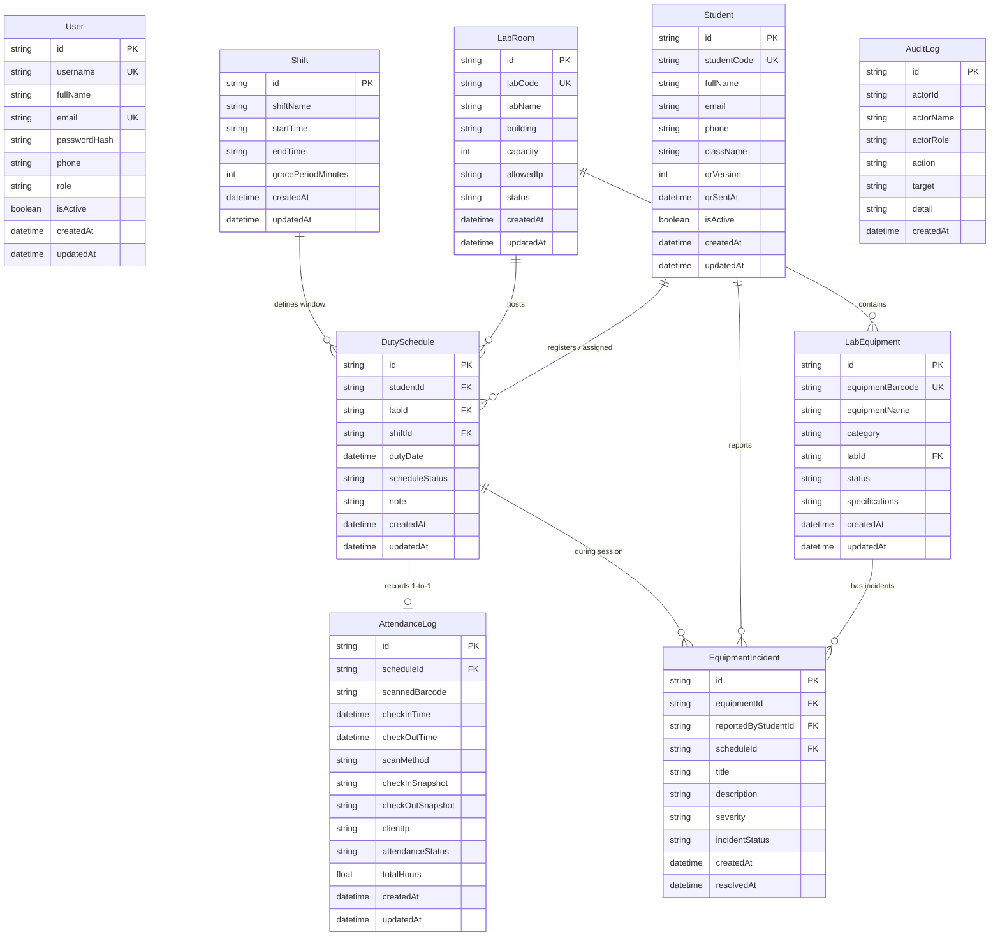

# Database ERD & CRUD Matrix — VLU Lab QR Attendance System

## 1. Entity Relationship Diagram (ERD)

---

## 2. CRUD & API Permission Matrix

| Entity (Table) | Create (C) | Read (R) | Update (U) | Delete (D) | Roles / Access |
| :--- | :--- | :--- | :--- | :--- | :--- |
| **User** | `POST /api/users` | `GET /api/users`, `GET /api/auth/me` | `POST /api/auth/change-password` | `DELETE /api/users?id=...` | `ADMIN` (quản lý tài khoản); `ADMIN / LECTURER` (tự đổi mật khẩu) |
| **Student** | `POST /api/students`, `POST /api/students/import` | `GET /api/students`, `GET /api/students/qr` | `PUT /api/students`, `POST /api/students/qr` (thu hồi/cấp lại QR, gửi mail) | `DELETE /api/students` | `ADMIN / LECTURER` |
| **DutySchedule & AttendanceLog** | `POST /api/attendance/scan` (quét QR tại trạm), `POST /api/dashboard` (điểm danh thủ công) | `GET /api/dashboard`, `GET /api/attendance/scan` | `POST /api/attendance/scan` (Check-out), `PATCH /api/attendance/scan` (Check-out hộ) | — *(lưu lịch sử đối soát)* | Trạm quét công khai (`POST/GET /api/attendance/scan`), `ADMIN / LECTURER` (Dashboard & bổ sung) |
| **AuditLog** | Tự động ghi qua `recordAuditLog()` khi có thao tác quản trị | `GET /api/audit-logs` | — *(bất biến để đối soát)* | — *(bất biến để đối soát)* | Chỉ `ADMIN` xem |
| **LabEquipment & Incident** | `POST /api/equipments`, `POST /api/incidents/create` | `GET /api/equipments`, `GET /api/incidents` | `PATCH` / xử lý trạng thái | — | `ADMIN / LECTURER` |
